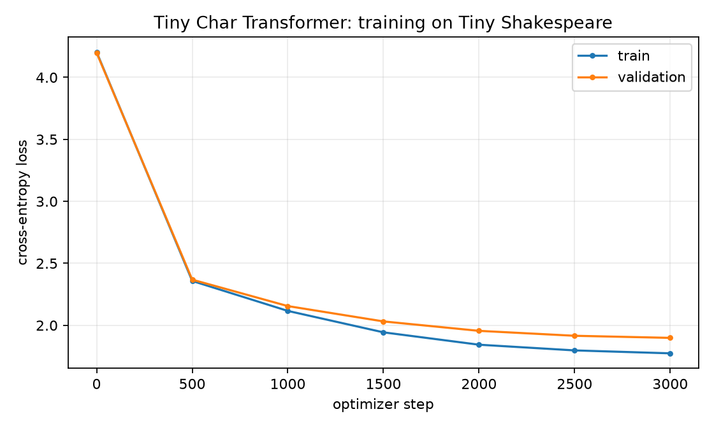

# Tiny Char Transformer

A compact, GPT-style character-level Transformer implemented directly in PyTorch. No pretrained weights and no `nn.TransformerEncoder`: token/position embeddings, causal multi-head attention, Pre-LN residual blocks, the training loop, and sampling are all visible in the code.

[中文](README.md) | **English**


---

## Why this exists

I am a mathematics undergraduate. Reading a derivation is not the same as building a model that trains, evaluates, and reproduces. This repository is a small but complete testbed for the whole chain:

**math → tensor shapes → training → held-out evaluation → sampling → explanation.**

It is deliberately not a leaderboard entry or a production LLM.

> "From scratch" here means **no pretrained weights and no high-level Transformer module**. PyTorch still provides linear layers, LayerNorm, and autograd; attention, masking, softmax, residual blocks, and the training loop are written out explicitly.

---

## Results

Trained on Tiny Shakespeare (1,115,394 characters, 65-character vocabulary):

| Metric | Value |
| --- | --- |
| Parameters | 818,048 (including biases and LayerNorm) |
| Layers / heads / width | 4 / 4 / 128 |
| Context length | 128 |
| Batch size | 32 |
| Optimizer steps | 3,000 |
| Best validation loss | 1.8988 |
| Validation perplexity | 6.68 |
| Hardware | CPU only (no GPU) |
| Training time | about 15.7 minutes |

Loss curve: [`results/loss_curve.png`](results/loss_curve.png) · metrics: [`results/metrics.json`](results/metrics.json) · samples: [`results/samples.txt`](results/samples.txt)



The 1,200-step baseline ([`results/runs/1200-steps.json`](results/runs/1200-steps.json)) reached a best validation loss of 2.2156 (perplexity 9.17). Extending the run to 3,000 steps lowered it to 1.8988. This is a budget comparison on one small model, not a scaling-law experiment.

Sample (`ROMEO:`, temperature 0.8, top-k 40, first 300 characters):

```text
ROMEO:
As good can the rich in the what nevers a like.

REOMENENTERS:
Why such were a creation a mores you
Parses as the a the was be land cand spee;
Will undicers the blising me as my sect,
The make to heads may this brabe well the dade
proce tus my doser of where I you my but heaven.

MENER:
Mast peary tan hear, him my cher head down,
And loownar give the with by whath call to me thou calll pay;
My an
```

The model is small, so the sample contains spelling and logical errors. The point is a reproducible result, not chat quality.

### Depth ablation: 2 layers vs 4 layers

Same data, seed, batch size, context length, optimizer, and **1,500-step budget**; only `n_layer` changes:

| Layers | Parameters | Best validation loss | Validation perplexity |
| --- | --- | --- | --- |
| 2 | 421,504 | 2.2799 | 9.78 |
| 4 | 818,048 | 2.0316 | 7.63 |

The 4-layer value is from the main 3,000-step run at step 1,500; the 2-layer number is a separate run. Artifacts are in [`results/ablation_2layer/`](results/ablation_2layer/).

This is one seed and one budget, not a scaling-law study. It shows that extra depth used its capacity on this small corpus; it does not prove that more layers always help.

---

## Quickstart

```bash
git clone https://github.com/Wang-xinyu-2007/tiny-char-transformer.git
cd tiny-char-transformer
python -m pip install -r requirements-dev.txt

# Downloads Tiny Shakespeare and verifies its SHA-256.
python train.py

# Continue from the best checkpoint.
python generate.py --prompt "ROMEO:" --tokens 300

# Optional: compare KV-cache and recomputed decoding.
python benchmark.py

python -m pytest -q
```

`requirements-dev.txt` includes runtime dependencies, pytest, and Ruff; use `requirements.txt` if you only need training and sampling.

Fast smoke test:

```bash
python train.py --max_steps 50 --eval_interval 25 --eval_iters 5
```

The default run takes about 16 minutes on a CPU. See `python train.py --help` for all options.

---

## Architecture

```text
character ids
  → token embedding + learned position embedding
  → 4 × [ Pre-LN → causal multi-head attention → residual
          Pre-LN → GELU MLP (4×) → residual ]
  → final LayerNorm
  → lm_head (tied to token embedding)
  → next-character logits
```

| Component | Implementation |
| --- | --- |
| Tokenizer | Character-level, 65 symbols, no BPE |
| Attention | 4 heads, `d_head = 32`, explicit `softmax(QKᵀ/√d_k + mask)` |
| Mask | Lower-triangular causal mask, future logits set to `-inf` |
| Block | Pre-LN, residual connections, GELU, 4× MLP |
| Output | Weight tying (`lm_head.weight = wte.weight`) |
| Initialization | Normal(0, 0.02); residual projections scaled by `1/√(2N)` |
| Optimization | AdamW, linear warmup + cosine decay, gradient clipping at 1.0 |
| Evaluation | Fixed validation split; best validation-loss checkpoint |
| Generation | KV-cache incremental decoding; falls back to window recomputation beyond `block_size` |

`F.scaled_dot_product_attention` is intentionally not used: the attention matrix, mask, softmax, and dropout are written out so they can be checked against the equations. A production implementation should use a fused kernel.

---

## KV cache and incremental decoding

Vanilla generation recomputes the whole prefix at every step. This implementation stores each layer's keys and values:

```text
prefill:  prompt  → per-layer cache (K, V)
decode:   new token → Q for the current token only
          K/V appended to the cache
          dynamic causal mask: key_position <= query_position
```

`model.generate(..., use_cache=True)` uses the cache; `generate.py --no-cache` forces recomputation. The cache is used when `prompt + new_tokens <= block_size`. Because this model uses learned absolute position embeddings, sliding past the window would require re-encoding the old keys/values, so longer generations fall back to recomputation. That is an explicit implementation boundary, not a bug.

CPU benchmark over 96 tokens (`python benchmark.py`, JSON in [`results/cache_benchmark.json`](results/cache_benchmark.json)):

| Mode | tokens/s | Relative |
| --- | --- | --- |
| Recomputation | 406.7 | 1.00× |
| KV cache | 533.9 | **1.31×** |

The model is tiny with a 128-token window, so the gain is limited. Cached and uncached greedy outputs are tested to be identical.

---

## Layout

```text
charformer/
  model.py        # GPTConfig, CausalSelfAttention, MLP, Block, GPT
  data.py         # tokenizer, checksum-verified download, batch sampler
train.py          # training loop, evaluation, checkpointing, plots, sample
generate.py       # continuation from a checkpoint (cache on/off)
benchmark.py      # cached vs recomputed decoding
docs/math.md      # derivations: cross-entropy, attention, masks, backprop
tests/            # 17 unit tests, including causal-leakage and KV-cache tests
results/          # committed metrics, loss curve, sample, cache benchmark
```

Suggested reading order: `data.py` → `model.py` → `tests/test_model.py` → `tests/test_cache.py` → `train.py` → `docs/math.md`. Start with shapes and the mask test, then incremental decoding, then match each equation in the notes to the code.

The math notes are currently written in Chinese. The code, docstrings, and this README are in English.

---

## Tests

```bash
python -m pytest -q
```

The suite covers forward shapes, finite loss, causal leakage, generation length, block-size rejection, weight tying, tokenizer round-trip, shifted targets, and the train/validation split. KV-cache tests check prefill vs full forward, incremental token vs full sequence, cached vs uncached greedy generation, cache length, and the long-generation fallback.

The two key invariants are causal leakage (no future information) and cache consistency (no missing or extra position).

---

## Design choices and limitations

- **Character-level, not BPE:** small vocabulary and a simple pipeline make attention and optimization easy to inspect.
- **0.8M parameters:** CPU-trainable, but capacity is limited; samples contain errors.
- **KV cache has a boundary:** it reuses keys/values inside `block_size`; beyond that it falls back to recomputation because absolute positions cannot be shifted without re-encoding.
- **No mixed precision or distributed training:** this is a single-device teaching implementation.
- **One corpus:** the validation loss measures Shakespeare-style fitting, not general English understanding.

Natural next steps: BPE tokenization, RoPE / relative positions, a FlashAttention comparison, width ablations, multi-seed stability runs, and a larger held-out corpus.

---

## Data and credits

- Corpus: [Tiny Shakespeare](https://github.com/karpathy/char-rnn/tree/master/data/tinyshakespeare), public-domain text; the download is SHA-256 verified.
- Design references: Vaswani et al. (2017), GPT-2 (Radford et al., 2019), and nanoGPT (Karpathy). The implementation here is independent.
- Derivations and references: [`docs/math.md`](docs/math.md).

## License

MIT
